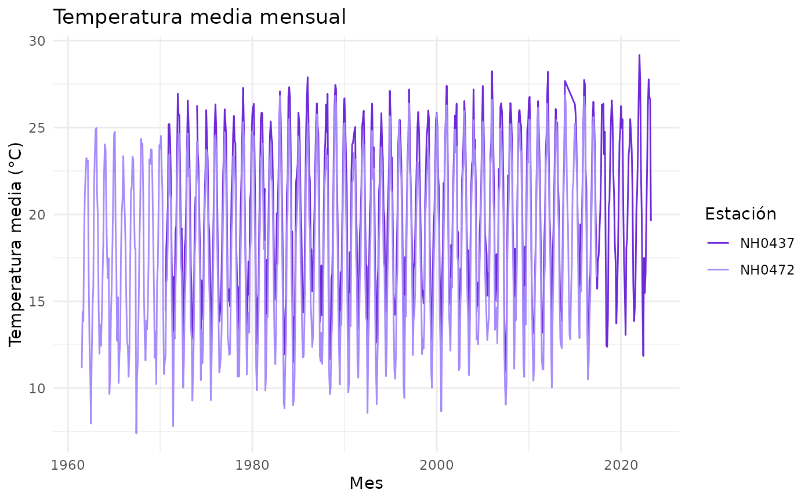

# Uso de lloRando

## Introducción

**lloRando** permite leer, resumir y graficar datos meteorológicos del
INTA. En esta guía vamos a recorrer las tres funciones principales con
ejemplos.

``` r

library(lloRando)
```

## Los datos

El paquete incluye el dataset `estaciones`, con datos diarios de cinco
estaciones.

``` r

dim(estaciones)
#> [1] 95681    35
head(estaciones[c("id", "fecha", "temperatura_abrigo_150cm")])
#>       id      fecha temperatura_abrigo_150cm
#> 1 NH0046 1973-01-01                    27.00
#> 2 NH0046 1973-01-02                    27.20
#> 3 NH0046 1973-01-03                    25.15
#> 4 NH0046 1973-01-04                    26.45
#> 5 NH0046 1973-01-05                    26.05
#> 6 NH0046 1973-01-06                    20.45
```

## Resumir la temperatura

[`tabla_resumen_temperatura()`](https://maipochettino.github.io/lloRando/reference/tabla_resumen_temperatura.md)
calcula el promedio y el desvío

``` r

tabla_resumen_temperatura(estaciones)
#> # A tibble: 10 × 3
#>    id     estadistico valor
#>    <chr>  <chr>       <dbl>
#>  1 NH0046 media       17.3 
#>  2 NH0046 desvio       5.90
#>  3 NH0098 media       18.6 
#>  4 NH0098 desvio       5.98
#>  5 NH0437 media       20.2 
#>  6 NH0437 desvio       5.77
#>  7 NH0472 media       18.0 
#>  8 NH0472 desvio       5.94
#>  9 NH0910 media       17.7 
#> 10 NH0910 desvio       6.12
```

También podemos filtrar algunas estaciones antes de resumir:

``` r

seleccion <- estaciones[estaciones$id %in% c("NH0437", "NH0472"), ]
tabla_resumen_temperatura(seleccion)
#> # A tibble: 4 × 3
#>   id     estadistico valor
#>   <chr>  <chr>       <dbl>
#> 1 NH0437 media       20.2 
#> 2 NH0437 desvio       5.77
#> 3 NH0472 media       18.0 
#> 4 NH0472 desvio       5.94
```

## Graficar la temperatura mensual

[`grafico_temperatura_mensual()`](https://maipochettino.github.io/lloRando/reference/grafico_temperatura_mensual.md)
muestra el promedio de cada mes del año. Podemos cambiar los colores y
el título:

``` r

seleccion <- estaciones[estaciones$id %in% c("NH0437", "NH0472"), ]

grafico_temperatura_mensual(
  seleccion,
  colores = c(NH0437 = "#6d28d9", NH0472 = "#a78bfa"),
  titulo = "Temperatura media mensual"
)
#> Warning: Removed 1 row containing missing values or values outside the scale range
#> (`geom_line()`).
```


