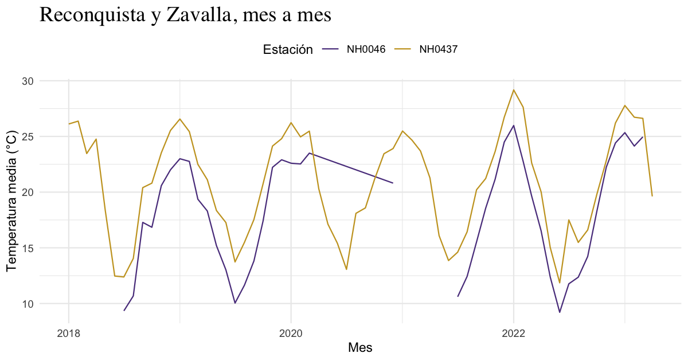

# lloRando

Número 01 · Santa Fe, Argentina · Datos del INTA

> Porque a veces el clima te hace llorar… y los datos meteorológicos
> también.

Hay paquetes que resuelven problemas y hay paquetes que te acompañan
mientras los resolvés. *lloRando* es de los segundos. Toma los archivos
diarios de las estaciones meteorológicas del INTA, esos CSV de treinta y
cinco columnas que nadie quiere abrir un lunes, y los convierte en una
tabla prolija y en un gráfico que se entiende de un vistazo.

Tres funciones, un dataset y ninguna excusa para no mirar el clima con
otros ojos.

## El clima, en cifras

95.681observaciones diarias

5estaciones

67años de registros

1956primer dato

Todo eso viene incluido en el paquete, en el dataset `estaciones`. Lo
instalás y ya lo tenés: sin descargas, sin rutas, sin sufrimiento.

## Las protagonistas

Cinco estaciones de la provincia de Santa Fe, de norte a sur, con
décadas de mediciones a cuestas.

| Estación         | Id       | Registros   |
|------------------|----------|-------------|
| INTA Reconquista | `NH0437` | 1970 – 2023 |
| INTA Rafaela     | `NH0098` | 1956 – 2023 |
| INTA Oliveros    | `NH0472` | 1961 – 2017 |
| Las Rosas        | `NH0910` | 1975 – 2017 |
| UNR Zavalla      | `NH0046` | 1973 – 2023 |

Cada fila del dataset es un día en una estación. Las columnas que más
vas a usar son estas:

``` r

head(estaciones[c("id", "fecha", "temperatura_abrigo_150cm")])
#> # A tibble: 6 × 3
#>   id     fecha      temperatura_abrigo_150cm
#>   <chr>  <date>                        <dbl>
#> 1 NH0046 1973-01-01                     27  
#> 2 NH0046 1973-01-02                     27.2
#> 3 NH0046 1973-01-03                     25.2
#> 4 NH0046 1973-01-04                     26.4
#> 5 NH0046 1973-01-05                     26.0
#> 6 NH0046 1973-01-06                     20.4
```

- `id`: el código de la estación.
- `fecha`: el día de la observación.
- `temperatura_abrigo_150cm`: la temperatura media, en °C, medida a 150
  cm del suelo dentro del abrigo meteorológico.

## Instalación

*lloRando* vive en GitHub. Para instalarlo:

``` r

install.packages("remotes")
remotes::install_github("maipochettino/lloRando")
```

Y para empezar:

``` r

library(lloRando)
```

## En tres gestos

### I. Descargar

[`descargar_estacion()`](https://maipochettino.github.io/lloRando/reference/descargar_estacion.md)
trae los datos de cualquier estación del repositorio del curso. Si el
archivo ya está en tu compu, no lo vuelve a descargar: lo lee
directamente.

``` r

datos <- descargar_estacion(id = "NH0437", ruta = "datos/NH0437.csv")
```

### II. Resumir

[`tabla_resumen_temperatura()`](https://maipochettino.github.io/lloRando/reference/tabla_resumen_temperatura.md)
calcula el promedio y el desvío estándar de la temperatura de cada
estación, en formato largo. Los días sin dato se ignoran.

``` r

tabla_resumen_temperatura(estaciones)
#> # A tibble: 10 × 3
#>    id     estadistico valor
#>    <chr>  <chr>       <dbl>
#>  1 NH0046 media       17.3 
#>  2 NH0046 desvio       5.90
#>  3 NH0098 media       18.6 
#>  4 NH0098 desvio       5.98
#>  5 NH0437 media       20.2 
#>  6 NH0437 desvio       5.77
#>  7 NH0472 media       18.0 
#>  8 NH0472 desvio       5.94
#>  9 NH0910 media       17.7 
#> 10 NH0910 desvio       6.12
```

¿Solo algunas estaciones? Filtralas antes:

``` r

norte_sur <- estaciones[estaciones$id %in% c("NH0437", "NH0046"), ]

tabla_resumen_temperatura(norte_sur)
#> # A tibble: 4 × 3
#>   id     estadistico valor
#>   <chr>  <chr>       <dbl>
#> 1 NH0046 media       17.3 
#> 2 NH0046 desvio       5.90
#> 3 NH0437 media       20.2 
#> 4 NH0437 desvio       5.77
```

### III. Graficar

[`grafico_temperatura_mensual()`](https://maipochettino.github.io/lloRando/reference/grafico_temperatura_mensual.md)
promedia la temperatura de cada mes y la dibuja como una línea por
estación. Podés elegir los colores y el título, y como devuelve un
gráfico de ggplot2, también podés seguir editándolo.

``` r

recientes <- norte_sur[norte_sur$fecha >= as.Date("2018-01-01"), ]

grafico_temperatura_mensual(
  recientes,
  colores = c(NH0437 = "#5B3F8C", NH0046 = "#C9A227"),
  titulo = "Reconquista y Zavalla, mes a mes"
) +
  ggplot2::theme(
    plot.title = ggplot2::element_text(family = "serif", size = 18),
    legend.position = "top"
  )
```



Reconquista, más al norte, se mantiene siempre unos grados por encima de
Zavalla, y los inviernos se separan más que los veranos.

## Detrás de escena

- \*\*Sin
