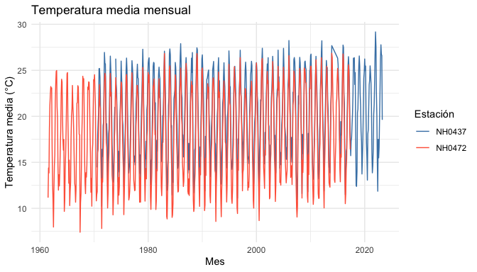

# lloRando

> Porque a veces el clima te hace llorar… y los datos meteorológicos
> también. 😭

*lloRando* es un paquete de R que te lleva de un CSV del INTA a un
gráfico del clima en pocas líneas: leé, resumí y graficá datos diarios
de estaciones meteorológicas sin sufrir en el intento.

⚠️ *Proyecto de práctica para Introducción a la Programación II. Es un
paquete de prueba y no está pensado para un uso real.*

## ⚡ En 30 segundos

``` r

library(lloRando)

tabla_resumen_temperatura(estaciones)
grafico_temperatura_mensual(estaciones)
```

## 🛠️ Instalación

``` r

install.packages("remotes")
remotes::install_github("maipochettino/lloRando")
```

## 🧰 ¿Qué incluye?

| Función | Para qué sirve |
|----|----|
| [`descargar_estacion()`](https://maipochettino.github.io/lloRando/reference/descargar_estacion.md) | Descarga (o lee, si ya existe) los datos de una estación |
| [`tabla_resumen_temperatura()`](https://maipochettino.github.io/lloRando/reference/tabla_resumen_temperatura.md) | Promedio y desvío de la temperatura por estación |
| [`grafico_temperatura_mensual()`](https://maipochettino.github.io/lloRando/reference/grafico_temperatura_mensual.md) | Temperatura media mensual de cada estación |
| `estaciones` | Dataset con 5 estaciones listo para usar |

## 🗂️ Datos incluidos

El dataset `estaciones` reúne observaciones diarias de cinco estaciones
del INTA: **NH0472, NH0910, NH0046, NH0098 y NH0437**.

``` r

library(lloRando)

dim(estaciones)
#> [1] 95681    35

unique(estaciones$id)
#> [1] "NH0046" "NH0098" "NH0437" "NH0472" "NH0910"

head(estaciones[c("id", "fecha", "temperatura_abrigo_150cm")])
#>       id      fecha temperatura_abrigo_150cm
#> 1 NH0046 1973-01-01                    27.00
#> 2 NH0046 1973-01-02                    27.20
#> 3 NH0046 1973-01-03                    25.15
#> 4 NH0046 1973-01-04                    26.45
#> 5 NH0046 1973-01-05                    26.05
#> 6 NH0046 1973-01-06                    20.45
```

- `id`: identifica la estación.
- `fecha`: día de la observación.
- `temperatura_abrigo_150cm`: temperatura en °C a 150 cm del suelo.

Los datos originales vienen del [repositorio del
curso](https://github.com/rse-r/intro-programacion/tree/main/datos).

## 📥 Descargar datos de una estación

[`descargar_estacion()`](https://maipochettino.github.io/lloRando/reference/descargar_estacion.md)
recibe el id de la estación y la ruta donde guardar el CSV. Si el
archivo ya existe, lo lee directamente; si no, lo descarga primero.
Necesita Internet, así que este ejemplo no se ejecuta al construir el
README:

``` r

datos <- descargar_estacion(id = "NH0437", ruta = "datos/NH0437.csv")

head(datos)
```

## 🌡️ Resumir la temperatura

``` r

tabla_resumen_temperatura(estaciones)
#> # A tibble: 10 × 3
#>    id     estadistico valor
#>    <chr>  <chr>       <dbl>
#>  1 NH0046 media       17.3 
#>  2 NH0046 desvio       5.90
#>  3 NH0098 media       18.6 
#>  4 NH0098 desvio       5.98
#>  5 NH0437 media       20.2 
#>  6 NH0437 desvio       5.77
#>  7 NH0472 media       18.0 
#>  8 NH0472 desvio       5.94
#>  9 NH0910 media       17.7 
#> 10 NH0910 desvio       6.12
```

¿Querés solo algunas estaciones? Filtralas antes:

``` r

seleccion <- estaciones[estaciones$id %in% c("NH0437", "NH0472"), ]

tabla_resumen_temperatura(seleccion)
#> # A tibble: 4 × 3
#>   id     estadistico valor
#>   <chr>  <chr>       <dbl>
#> 1 NH0437 media       20.2 
#> 2 NH0437 desvio       5.77
#> 3 NH0472 media       18.0 
#> 4 NH0472 desvio       5.94
```

Los valores faltantes (`NA`) se ignoran en los cálculos.

## 📊 Graficar la temperatura mensual

El gráfico muestra la temperatura media de cada mes, para cada estación.
Podés elegir los colores y el título:

``` r

grafico_temperatura_mensual(
  seleccion,
  colores = c(NH0437 = "steelblue", NH0472 = "tomato"),
  titulo = "Temperatura media mensual"
)
#> Warning: Removed 1 row containing missing values or values outside the scale range
#> (`geom_line()`).
```



## 📚 Documentación

Cada función tiene su ayuda dentro de R:

``` r

?descargar_estacion
?tabla_resumen_temperatura
?grafico_temperatura_mensual
?estaciones
```

La guía de uso completa está en el [sitio web del
paquete](https://maipochettino.github.io/lloRando/).

## 👩‍💻 Autoras

- Mailén Pochettino
- Ornella Quintanilla
- Candela Cambiaso

## 📄 Licencia

Código bajo licencia MIT. Mirá
[LICENSE.md](https://maipochettino.github.io/lloRando/LICENSE.md).
